# End-to-End System Design Architecture & Workflow Blueprint

Yeh document image me diye gaye Miro board diagram ka ek highly detailed, advance, aur clear production-ready breakdown hai. Iss document me ASCII visual text diagrams aur Mermaid.js renderable flowcharts dono include kiye gaye hain.

---

## 1. ASCII Text Architecture Diagram

```
                                  ====================================================
                                      SYSTEM DESIGN COMPLETE END-TO-END WORKFLOW
                                  ====================================================
                                                           |
     +---------------------------+-------------------------+--------------------------+---------------------------+
     |                           |                                                    |                           |
     v                           v                                                    v                           v
+-----------------------+   +-----------------------+                            +-----------------------+   +-----------------------+
|  1. HIGH LEVEL DESIGN |   |  2. LOW LEVEL DESIGN  |                            |   3. TESTING & QA     |   | 4. BACKUP & ARCHIVAL  |
|        (HLD)          |   |        (LLD)          |                            |       STRATEGY        |   |       STRATEGY        |
+-----------------------+   +-----------------------+                            +-----------------------+   +-----------------------+
     |                           |                                                    |                           |
     +---> Tech Stack            +---> Class Diagrams                                 +---> Load Testing          +---> Hot DB Backup
     |     (Frontend/Backend)    |                                                    |     (k6, Autocannon)      |     (Multi-Region)
     |                           +---> DB Schemas                                     |                           |
     +---> CDN & Edge Caching    |     (Tables, Indexing, ERD)                        +---> Stress Testing        +---> Cold Storage
     |                           |                                                    |     (Break-point Analysis)|     (AWS S3 Glacier)
     +---> Load Balancers        +---> API Endpoints                                  |                           |
     |     (NGINX, ALB, L4/L7)   |     (REST, gRPC, GraphQL)                          +---> Security Testing      +---> Lifecycle Policies
     |                           |                                                    |     (Snyk, Dependency)    |     (Data Retention)
     +---> Core Services         +---> Business Logic &                               |                           |
     |     (Microservices/API)   |     Design Patterns                                +---> Vulnerability         +---> Static Assets
     |                           |                                                          Scanning (OWASP)            (Blob Storage Backup)
     +---> Caching Layer         +---> Error Handling &                               
     |     (Redis, Memcached)          Validation                                     
     |                                                                                
     +---> Databases                                                                  
     |     (CAP Theorem Trade-offs)                                                   
     |                                                                                
     +---> Async Queues                                                               
           (Kafka, RabbitMQ)                                                          
```

---

## 2. Advanced Interactive Mermaid.js Flowchart

> *Note: If you view this file in VS Code, GitHub, or Obsidian, the diagram below will automatically render into a graphical flowchart.*

```mermaid
graph TD
    %% Main System Design Node
    SD[System Design Architecture Workflow] --> HLD[1. High Level Design - HLD]
    SD --> LLD[2. Low Level Design - LLD]
    SD --> TEST[3. Testing & Validation]
    SD --> STRAT[4. Backup & Archival Strategy]

    %% HLD Subgraph
    subgraph HLD_SECTION [High Level Design Framework]
        HLD --> TECH[Technology Stack Selection]
        TECH --> FE_BE[Frontend & Backend Frameworks]
        HLD --> CAP[Database Tier - CAP Theorem Trade-offs]
        CAP --> DB_TYPE{SQL vs NoSQL Choice}
        DB_TYPE -->|CP System| SQLDB[Relational: Postgres / MySQL]
        DB_TYPE -->|AP System| NOSQLDB[NoSQL: Cassandra / DynamoDB]
        HLD --> SERV[Microservices Architecture]
        SERV --> ASYNC[Message Queues: Kafka / RabbitMQ]
        HLD --> LB[Load Balancing Layer - Nginx / ALB]
        HLD --> CACHE[Caching Strategy]
        CACHE --> L1[L1: CDN / Cloudflare]
        CACHE --> L2[L2: Distributed Cache / Redis]
    end

    %% LLD Subgraph
    subgraph LLD_SECTION [Low Level Design Framework]
        LLD --> SCHEMA[Database Schema Design]
        SCHEMA --> INDEX[Indexes & ER Diagrams]
        LLD --> APIS[API Specs & Endpoint Contracts]
        APIS --> PROTOCOL[REST / gRPC / GraphQL]
        LLD --> FUNC[Core Business Logic & Class Diagrams]
        FUNC --> PATTERNS[Design Patterns & SOLID Principles]
    end

    %% Testing Subgraph
    subgraph TEST_SECTION [Testing & Resilience Pipeline]
        TEST --> LOAD[Load Testing]
        LOAD --> K6_AUTO[Tools: k6 / Autocannon]
        TEST --> STRESS[Stress & Spike Testing]
        STRESS --> BREAK[Find System Breakpoint]
        TEST --> SEC[Security Analysis]
        SEC --> SNYK[Snyk / Vulnerability & Package Audits]
    end

    %% Backup & Archival Subgraph
    subgraph BACKUP_SECTION [Backup & Archival Resilience]
        STRAT --> DB_BACKUP[Database Backups]
        DB_BACKUP --> HOT_SNAP[Automated Point-In-Time Snapshots]
        STRAT --> ASSET_BACKUP[Static Assets Backup]
        ASSET_BACKUP --> S3_BLOB[AWS S3 / GCP Cloud Storage]
        STRAT --> ARCHIVE[Cold Data Archival]
        ARCHIVE --> GLACIER[AWS S3 Glacier / Automated Lifecycle Rules]
    end
```



---

## 3. Deep-Dive Component Breakdown

### Section 1: High-Level Design (HLD)
High-Level Design system ka macroscopic view hota hai—yeh dikhata hai ki system ke alag-alag large components ek dusre ke sath kaise communicate karte hain.

1. **Technology Stack:** Frontend (React, Next.js), Backend (Node.js, Go, Java), Gateway (Kong, Nginx).
2. **Database & CAP Theorem:** 
   - **CP Systems:** Heavy financial consistency ke liye Relational DBs (PostgreSQL/MySQL).
   - **AP Systems:** Massive scale aur high availability ke liye Distributed NoSQL DBs (Cassandra, DynamoDB).
3. **Services Layer:** Monolith vs Microservices. Event-driven architecture ke liye Kafka ya RabbitMQ ka upayog.
4. **Load Balancing:** Ingress traffic ko multi-zone application instances par distribute karna (Layer 4 vs Layer 7 routing).
5. **Multi-Tier Caching:** CDN for static assets (Images, JS) aur In-Memory Cache (Redis) for database read queries.

---

### Section 2: Low-Level Design (LLD)
Low-Level Design system ke granular implementation par focus karta hai.

1. **Database Schema:** Tables, Foreign Keys, Primary Keys, Normalization, aur Search Queries ko speedup karne ke liye Indexing Strategies.
2. **Endpoints & APIs:** Request/Response payloads, Input validation rules, Status codes, Protocol buffers (gRPC for internal microservices, REST/GraphQL for clients).
3. **Core Functionality & Design Patterns:** SOLID principles, Factory, Singleton, Strategy patterns ka use, modular clean code design.

---

### Section 3: Testing Strategy
Deploy karne se pehle system kitna load aur security threats handle kar sakta hai, usse test karna.

1. **Load Testing:** Standard traffic volume par response times aur memory usage verify karna (**Tools:** `k6`, `Autocannon`).
2. **Stress & Spike Testing:** Traffic ko maximum limits tak push karke breaking point dhundna aur auto-recovery test karna.
3. **Security Audits:** Codebase aur dependencies ke vulnerabilities ko patch karna (**Tools:** `Snyk`, `OWASP ZAP`).

---

### Section 4: Backup & Archival Strategy
Disaster recovery aur data retention policies ko enforce karna.

1. **Database Backup:** Live Write Replicas aur Automated Daily Snapshots (Point-in-time recovery).
2. **Static Asset Backup:** User files (Images, PDFs) ko multi-region blob storage me replicate karna.
3. **Archival (Cold Storage):** Old logs aur 1 saal se purane inactive data ko saste cold storage (e.g., AWS S3 Glacier) me move karna, taaki primary DB light aur fast rahe.